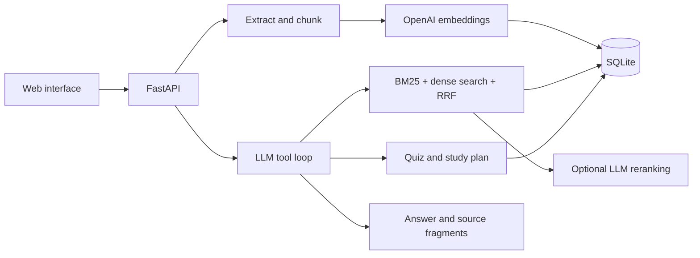

# CoursePilot

**AI-ассистент для обучения по материалам курсов.** Отвечает на вопросы с указанием источников, объясняет темы, создаёт тесты и составляет план занятий с учётом результатов пользователя.

Python · FastAPI · OpenAI Responses API · Hybrid RAG · SQLite · NumPy

## Работа с ассистентом

1. Добавьте PDF с текстовым слоем, Markdown или TXT. Можно начать со встроенного курса по машинному обучению.
2. Спросите: «Чем переобучение отличается от недообучения? Покажи пример из курса».
3. Получите объяснение и откройте фрагменты источников с названием раздела и номером страницы.
4. Попросите тест, ответьте на три вопроса и изучите разбор ошибок.
5. Укажите цель и время на занятия. Ассистент сохранит план с опорой на материалы и результаты тестов.

## Возможности

- Импорт PDF, Markdown и TXT с ограничением размера и проверкой наличия текста.
- Разбиение с учётом Markdown-заголовков, перекрытием фрагментов и сохранением страниц PDF.
- Эмбеддинги OpenAI с постоянным кэшем, привязанным к тексту и модели.
- Гибридный поиск: BM25 + косинусное сходство эмбеддингов, объединение через Reciprocal Rank Fusion.
- Опциональный LLM-reranking первых десяти кандидатов.
- Ограниченный цикл tool calling: поиск, чтение прогресса, создание теста и плана.
- Проверка идентификаторов цитат. Предметный ответ после поиска без ссылки заменяется сообщением об отсутствии подтверждения.
- Структурированные тесты и планы через Pydantic и Structured Outputs.
- Проверка тестов на сервере: правильные варианты не передаются в браузер до отправки ответов; первая попытка фиксируется.
- История последних 12 сообщений, результаты и планы сохраняются в SQLite отдельно для профиля браузера и курса.
- Повторная загрузка документа с тем же именем атомарно заменяет его фрагменты. При ошибке API старый документ сохраняется.
- Русскоязычный адаптивный интерфейс без отдельной сборки frontend.

## Быстрый запуск

### Windows / PowerShell

Откройте PowerShell в папке проекта:

```powershell
py -3 -m venv .venv
.\.venv\Scripts\python.exe -m pip install -r requirements.lock.txt
Copy-Item .env.example .env.local
notepad .env.local
```

В локальном файле `.env.local` задайте `OPENAI_API_KEY`. Не публикуйте этот файл. Запуск:

```powershell
.\.venv\Scripts\python.exe -m uvicorn coursepilot.api:app --host 127.0.0.1 --port 8000
```

Откройте [http://127.0.0.1:8000](http://127.0.0.1:8000). Во вкладке «Материалы курса» нажмите «Добавить курс по ML». Курс индексируется через OpenAI Embeddings API. После этого можно задавать вопросы.

Активация окружения не требуется, поэтому менять политику выполнения PowerShell не нужно.

### macOS / Linux

```bash
python3 -m venv .venv
.venv/bin/python -m pip install -r requirements.lock.txt
cp .env.example .env.local
# Set OPENAI_API_KEY in .env.local
.venv/bin/python -m uvicorn coursepilot.api:app --host 127.0.0.1 --port 8000
```

### Docker

Создайте `.env.local`, затем:

```bash
docker compose up --build
```

Интерфейс будет доступен на `http://127.0.0.1:8000`. Данные сохраняются в Docker volume. Контейнер запускается от отдельного пользователя, ключ передаётся при запуске и не включается в образ.

## Настройки

| Переменная | По умолчанию | Назначение |
| --- | --- | --- |
| `OPENAI_API_KEY` | — | Ключ OpenAI API |
| `OPENAI_MODEL` | `gpt-4.1-mini` | Модель ответов, инструментов и структурированной генерации |
| `EMBEDDING_MODEL` | `text-embedding-3-small` | Модель эмбеддингов |
| `RERANK_ENABLED` | `false` | Дополнительное ранжирование через LLM |
| `COURSEPILOT_DATA_DIR` | `runtime` | База данных и кэш |

После изменения настроек перезапустите сервис. При смене модели эмбеддингов переиндексируйте все документы курса. Система отклоняет поиск по смешанному индексу.

API-запросы платные: загрузка создаёт эмбеддинги, вопрос использует эмбеддинг и один или несколько вызовов LLM. Тесты, планы и reranking добавляют вызовы. Повторно используемые эмбеддинги берутся из кэша. Расход токенов возвращается в ответе `/api/chat`; стоимость в валюте не рассчитывается.

## Архитектура



SQLite хранит текст, эмбеддинги, кэш и прогресс. Косинусное сходство вычисляется через NumPy. Это позволяет запустить приложение без отдельного сервера векторной базы. Для больших коллекций потребуется другой способ хранения и поиска: текущая реализация читает фрагменты выбранного курса в память.

Подробнее о решениях и границах системы: [docs/architecture.md](docs/architecture.md).

## Оценка качества

В `evaluation/questions.json` — 30 вручную подготовленных вопросов: 24 с размеченным релевантным разделом и 6 без ответа в материалах. Разметка относится к встроенному авторскому курсу.

Результат выполненного лексического поиска на 24 вопросах и 24 фрагментах:

| Режим | Hit Rate@5 | MRR@5 |
| --- | --- | --- |
| BM25 | 1.000 | 0.925 |

Полная выдача сохранена в [evaluation/lexical_results.json](evaluation/lexical_results.json). Метрики относятся к поиску по встроенному курсу. Проверка ответов, цитирования и отказов описана в [протоколе оценки](evaluation/README.md).

Воспроизведение без API-ключа:

```bash
python -m evaluation.evaluate --mode lexical --output runtime/lexical-results.json
```

Для сравнения поиска с API доступны `--mode dense`, `--mode hybrid` и `--mode rerank`. Каждый запуск создаёт отдельный индекс; эмбеддинги могут оплачиваться заново.

Проверка интеграции с OpenAI:

```bash
python -m scripts.smoke_live
```

Проверка создаёт эмбеддинги, получает ответ с источником, генерирует тест и план, проверяет ответ на посторонний вопрос. Использует отдельную базу `runtime/smoke.sqlite3` и платные API-вызовы. Результаты сохраняются в `runtime/live_smoke.json`.

Протокол ручной проверки ответов: [evaluation/README.md](evaluation/README.md).

## Тесты

```bash
python -m pytest -q --basetemp=runtime/pytest
```

Тесты работают без API и проверяют разбиение, переиндексацию, изоляцию курсов и профилей, поиск, проверку цитат, цикл инструментов, API, сохранение планов и фиксацию первой попытки теста. В unit-тестах используется подменный провайдер; интеграция с OpenAI проверяется отдельно. Workflow GitHub Actions настроен для Python 3.11 и 3.12.

Результаты и объём выполненной проверки: [docs/verification.md](docs/verification.md).

## API

Swagger: [http://127.0.0.1:8000/docs](http://127.0.0.1:8000/docs).

| Метод | Путь | Назначение |
| --- | --- | --- |
| GET | `/api/status` | Настройки без ключа |
| GET | `/api/courses` | Индексированные курсы |
| POST | `/api/documents` | Загрузка документа, multipart `course` + `file` |
| POST | `/api/seed` | Индексация встроенного курса |
| POST | `/api/chat` | Диалог, источники, трасса инструментов, токены |
| POST | `/api/quiz` | Создание теста |
| POST | `/api/quiz/{id}/grade` | Проверка первой попытки |
| POST | `/api/plan` | Создание и сохранение плана |
| GET | `/api/progress?course=...` | Результаты и последний план |

## Данные и эксплуатация

Приложение рассчитано на личный локальный запуск. Библиотека документов общая для локальной установки. Профиль браузера отделяет историю и прогресс, но не является системой авторизации. Для публичного размещения нужны аутентификация, разграничение доступа к документам, HTTPS, ограничения нагрузки и отдельное управление секретами.

При загрузке текст передаётся в OpenAI для эмбеддингов. При ответе найденные фрагменты и часть истории передаются модели. Для Responses API используется `store=False`; это не означает отсутствия всех видов хранения на стороне провайдера. Не загружайте документы без права на их использование.

Проверка ссылки подтверждает существование фрагмента в выдаче, но не смысловую корректность каждого утверждения. Документы объявлены недоверенными данными в инструкциях, инструменты ограничены белым списком. Полная устойчивость к prompt injection не заявляется.

Сканированные PDF без текста требуют внешнего OCR. HTML, сложные таблицы и изображения в этой версии не индексируются. Исторические тесты и планы сохраняют снимки использованных источников; новые ответы используют текущий индекс.

## Публикация

Пошаговая инструкция: [docs/github-upload.md](docs/github-upload.md). Ключи, окружения, база и история исключены из Git и подготовленного архива.

Лицензия: [MIT](LICENSE). Тексты встроенного курса созданы для этого проекта и распространяются на тех же условиях.
